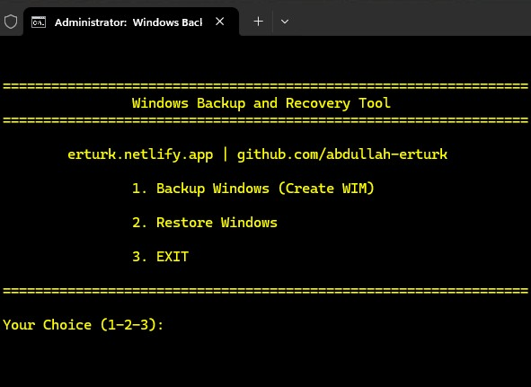
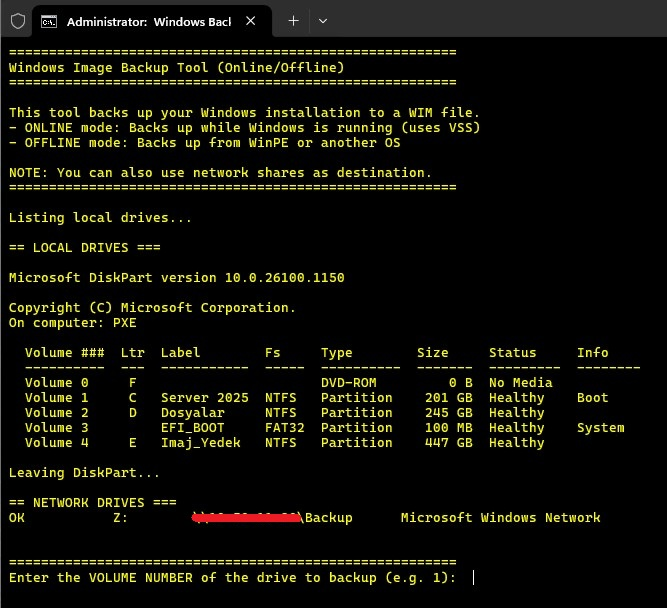
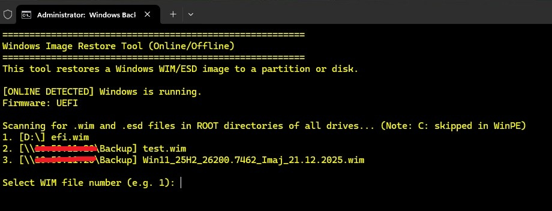

<a href="https://buymeacoffee.com/abdullaherturk" target="_blank"></a>

[](https://www.microsoft.com/)
[](https://github.com/abdullah-erturk/pmas/)
[](https://github.com/abdullah-erturk/Windows-Backup-Recovery-Tool)

# Windows Backup & Recovery Tool

## Link:

[](https://github.com/abdullah-erturk/Windows-Backup-Recovery-Tool/archive/refs/heads/main.zip)

<details>
<summary><b>📸 Önizleme/Preview</b></summary>
  




</details>

 ---

<details>
<summary><b>Türkçe</b></summary>

## 🎯 Genel Bakış

Windows kurulumlarını yedeklemek ve geri yüklemek için kapsamlı bir komut satırı aracı. Hem çevrimiçi (çalışan Windows) hem de çevrimdışı (WinPE) ortamlarda çalışır.

Bu araç, sistem imajı yedekleri oluşturmak ve Windows kurulumlarını geri yüklemek için profesyonel bir çözüm sunar. **Öncelikli olarak yedekleme ve kurtarma işlemleri için tasarlanmış** olsa da, gerektiğinde sıfırdan Windows kurulumunda da kullanılabilir.

GUI Arayüz sevenler için: https://github.com/abdullah-erturk/Windows-Backup-Restore-Tool

## ✨ Öne Çıkan Özellikler

### 📦 Yedekleme (İmaj Oluşturma)
- **Çift Mod Desteği**
  - **Çevrimiçi Mod**: Windows çalışırken VSS (Volume Shadow Copy Service) kullanarak yedek alır
  - **Çevrimdışı Mod**: WinPE veya başka bir işletim sisteminden yedek alır
- **Akıllı VSS Yönetimi**: Tutarlı yedekler için otomatik snapshot oluşturur, VSS başarısız olursa doğrudan yedeklemeye geçer
- **Ağ Paylaşımı Desteği**: Yedekleri doğrudan ağ konumlarına kaydedin (SMB/CIFS)
- **Akıllı Hariç Tutma**: Geçici dosyaları, sayfa dosyalarını, bulut senkronizasyon klasörlerini otomatik hariç tutar
- **EFI/BIOS Desteği**: Hem modern UEFI hem de eski BIOS sistemlerini destekler
- **Özel EFI İşleme**: Sunucu sistemlerinde BCD kilit sorunlarını önlemek için staging metodolojisi kullanır

### 🔄 Geri Yükleme (İmaj Dağıtımı)
- **Esnek Geri Yükleme Seçenekleri**
  - Mevcut bölüme geri yükleme (formatla ve geri yükle)
  - Tüm diske geri yükleme (temizle, yeniden bölümle ve geri yükle)
- **Otomatik Firmware Algılama**: UEFI/BIOS firmware'ini algılar ve buna göre yapılandırır
- **Akıllı Önyükleme Onarımı**: Önyükleme bölümlerini otomatik bulur ve yapılandırır
- **Çoklu İmaj Desteği**: Birden fazla Windows sürümü içeren WIM dosyalarını destekler
- **Ağ Kaynağı Desteği**: Doğrudan ağ paylaşımlarından geri yükleme yapar
- **Güvenlik Özellikleri**: Çevrimiçi modda aktif sistem sürücüsünün yanlışlıkla üzerine yazılmasını önler

### 🌐 Genel Özellikler
- **İki Dilli Arayüz**: Otomatik algılama ile tam Türkçe ve İngilizce dil desteği
- **Ortam Algılama**: Çevrimiçi/Çevrimdışı (WinPE) ortamını otomatik algılar
- **Akıllı Sürücü Yönetimi**: Sürücü harflerini otomatik atar ve yönetir
- **Ağ Sürücü Algılama**: Eşlenmiş ağ sürücülerini tanır ve bunlarla çalışır
- **Kapsamlı Günlük Kaydı**: Sorun giderme için detaylı DISM günlükleri
- **İlerleme Göstergesi**: Uzun işlemler sırasında açık geri bildirim

## 📋 Gereksinimler

- Windows 10 veya üstü (çevrimiçi yedekleme için) (Windows 8.1 ve alt sürümler çevrimdışı modda yedeklenebilir ve geri yüklenebilir)
- Windows PE 5.0 veya üstü (çevrimdışı işlemler için)
- Yönetici yetkileri
- DISM (Deployment Image Servicing and Management) - Windows'ta dahildir
- Hedef sürücüde yeterli boş alan (yedek boyutu + ~%20)
- Proje ayrıca `findstr.exe` ve `robocopy.exe` dosyalarını da içermektedir. Bu dosyalar proje tarafından kullanılmaktadır ve bazı özelleştirilmiş WinPE imajlarında bulunmayabilir. Bu nedenle, kullanıcıların WinPE ortamında herhangi bir hatayla karşılaşmasını önlemek amacıyla bu iki dosya yedek olarak projeye dahil edilmiştir. Yalnızca çevrimiçi (VSS) olarak kullanacaksanız bu iki dosyayı silebilirsiniz.
  

## 🚀 Kullanım

### Temel İşlem

1. `RecoveryTool.bat` dosyasını Yönetici olarak çalıştırın
2. İşleminizi seçin:
   - Seçenek 1: Windows'u Yedekle (WIM oluştur)
   - Seçenek 2: Windows'u Geri Yükle
   - Seçenek 3: Çıkış

### Yedekleme İşlemi

1. Yedeklenecek kaynak birimi seçin (Windows kurulumunuz)
2. Hedefi seçin:
   - Yerel birim (sisteminizdeki başka bir sürücü)
   - Ağ paylaşımı (örn: `\\sunucu\yedek`)
3. WIM dosya adını girin (veya otomatik oluşturulan ad için boş bırakın)
4. Onaylayın ve tamamlanmasını bekleyin

Araç şunları yapacaktır:
- Hariç tutma listelerini otomatik oluşturur
- Çevrimiçi modda VSS snapshot'ları kullanır
- Gerekirse EFI bölümlerini özel staging ile işler
- Alan kazanmak için maksimum sıkıştırma uygular
- Yedekten sonra bütünlüğü doğrular

### Geri Yükleme İşlemi

1. Araç tüm sürücüleri WIM/ESD dosyaları için otomatik tarar (Sadece yerel ve ağ sücürücülerinin ana dizinini ve varsa sources klasörü (CD/DVD/ISOISO vb. kaynaklar için) içeriğini tarar)
2. Yedek dosyanızı seçin
3. İmaj indeksini seçin (WIM'de birden fazla sürüm varsa)
4. Geri yükleme türünü seçin:
   - **Birim Geri Yükleme**: Mevcut bölümü formatla ve geri yükle
   - **Disk Geri Yükleme**: Tüm diski temizle, yeniden bölümle ve geri yükle
5. Disk geri yükleme için firmware türünü seçin (UEFI/BIOS)
6. Onaylayın ve tamamlanmasını bekleyin

Araç şunları yapacaktır:
- Hedef bölümü/diski formatlar
- Windows imajını uygular
- Önyükleme bölümünü otomatik algılar ve yapılandırır
- Önyükleme kayıtlarını onarır (BCDBoot)
- Sistemin önyüklenebilir olmasını sağlar

## 🗂️ Dosya Yapısı

```
RecoveryTool/
├── RecoveryTool.bat          # Ana menü arayüzü
├── bin/
│   ├── imagecapture.bat      # Yedekleme motoru
│   ├── imagerestore.bat      # Geri yükleme motoru
│   ├── efi.txt               # UEFI bölümleme şablonu (isterseniz disk/bölüm boyutlarını özelleştirebilirsiniz)
│   └── bios.txt              # BIOS bölümleme şablonu (isterseniz disk/bölüm boyutlarını özelleştirebilirsiniz)
```

## 💡 Kullanım Senaryoları

### Birincil Kullanım: Yedekleme ve Kurtarma
- **Sistem Yedekleme**: Windows kurulumunuzun düzenli yedeklerini oluşturun
- **Felaket Kurtarma**: Donanım arızası veya bozulmadan sonra sisteminizi hızlıca geri yükleyin
- **Sistem Taşıma**: Windows kurulumunu yeni donanıma taşıyın
- **Güncelleme Öncesi Yedek**: Büyük güncellemelerden önce güvenlik yedeği oluşturun

### İkincil Kullanım: Temiz Kurulum
- **Sıfırdan Kurulum**: Yeni veya silinmiş sürücülere Windows dağıtın
- **Çoklu Önyükleme Kurulumu**: Ek Windows örnekleri kurun
- **Lab/Test Ortamı**: Test sistemlerinin hızlı dağıtımı

## 🔧 Gelişmiş Özellikler

### VSS Snapshot Teknolojisi
- Çalışan sistemlerin anlık görüntülerini oluşturur
- Yedekleme sırasında dosya tutarlılığını garanti eder
- VSS kullanılamıyorsa otomatik yedeklemeye geçer (FAT32 EFI bölümleri)

### EFI Staging
- Sunucularda EFI Sistem Bölümleri için özel işleme
- BCD kilit hatalarını önler (0x80070020)
- Güvenli yedekleme için geçici staging alanı oluşturur

### Akıllı Önyükleme Algılama
- GPT disklerde EFI Sistem Bölümünü otomatik bulur
- MBR disklerde Aktif bölümü konumlandırır
- Hem standart hem de standart olmayan yapılandırmaları işler

### Ağ Optimizasyonu
- Yüksek performanslı toplu ağ sürücü algılama
- Görünmez ağ sürücülerini işler (Windows 10)
- Hem eşlenmiş sürücüleri hem de UNC yollarını destekler

## ⚠️ Önemli Notlar

### Çevrimiçi Mod Kısıtlamaları
- Aktif sistem sürücüsüne (C:) yedekleme/geri yükleme yapılamaz
- Yönetici yetkileri gerektirir
- Bazı sistem dosyaları kullanımda olabilir

### Çevrimdışı Mod (WinPE) Avantajları
- Tüm bölümlere tam erişim
- Dosya kilitleme sorunları yok
- Sistem sürücüsünü yedekleyebilir/geri yükleyebilir
- Tam sistem kurtarma için önerilir

### Disk Geri Yükleme Uyarısı
**Disk geri yükleme hedef diskteki TÜM verileri silecektir!** Bu işlem:
- Tüm diski temizler
- Yeni bölüm tablosu oluşturur (UEFI için GPT, BIOS için MBR)
- Bölümleri formatlar
- Geri alınamaz

### Bölümleme Şablonları
Araç disk geri yükleme için bölümleme şablonları kullanır:
- `efi.txt`: EFI Sistem Bölümü ile GPT düzeni oluşturur (UEFI sistemler)
- `bios.txt`: Aktif önyükleme bölümü ile MBR düzeni oluşturur (Eski sistemler)

Bu şablonların betiklerle aynı dizinde bulunduğundan emin olun.

## 🐛 Sorun Giderme

### Yedekleme Sorunları
- **VSS Başarısız Olur**: Araç otomatik olarak doğrudan yedeklemeye geçer
- **Ağ Erişimi**: Kimlik bilgilerini ve yol erişilebilirliğini doğrulayın
- **Yetersiz Alan**: Hedefin yeterli boş alana sahip olduğundan emin olun
- **EFI BCD Kilidi**: Araç otomatik olarak staging yöntemini kullanır

### Geri Yükleme Sorunları
- **Önyükleme Başarısız**: Firmware türünün eşleştiğinden emin olun (UEFI vs BIOS)
- **Eksik Önyükleme Dosyaları**: Kaynak WIM'in tam Windows kurulumu içerdiğini doğrulayın
- **Sürücü Harfi Sorunları**: Araç harf atamasını otomatik olarak işler

### Yaygın Hata Kodları
- `0x80070020`: Dosya kullanımda (EFI senaryolarında otomatik işlenir)
- Erişim Reddedildi: Yönetici olarak çalıştırın
- Geçersiz İmaj: WIM dosya bütünlüğünü `dism /Get-ImageInfo` ile doğrulayın

## 📝 Lisans

Bu araç sistem yönetimi ve kişisel kullanım için olduğu gibi sağlanmaktadır. Üretim ortamlarında güvenmeden önce yedekleri her zaman test edin.

## 👤 Yazar

**Abdullah ERTURK**
- Web: [erturk.netlify.app](https://erturk.netlify.app)
- GitHub: [@abdullah-erturk](https://github.com/abdullah-erturk)

## 🤝 Katkıda Bulunma

Katkılar, sorunlar ve özellik istekleri memnuniyetle karşılanır! Issues sayfasını kontrol etmekten çekinmeyin.

---

**Not**: Yedeklerinizi her zaman test edin! Bir yedek, ancak ondan geri yükleme yapabildiğiniz kadar iyidir. Yedekleme stratejinizin etkili olduğundan emin olmak için periyodik olarak test geri yüklemeleri gerçekleştirin.

## ⭐ Yıldız

Bu aracı faydalı bulduysanız, lütfen bir yıldız vererek değerlendirin!
</details>

---

<details>
<summary><b>English</b></summary>

## 🎯 Overview

A comprehensive command-line tool for backing up and restoring Windows installations, with support for both online (running Windows) and offline (WinPE) environments.

This tool provides a professional solution for creating system image backups and restoring Windows installations. While **primarily designed for backup and recovery operations**, it can also be used for fresh Windows installations when needed.

For GUI Interface lovers: https://github.com/abdullah-erturk/Windows-Backup-Restore-Tool


## ✨ Key Features

### 📦 Backup (Image Capture)
- **Dual-Mode Operation**
  - **Online Mode**: Create backups while Windows is running using VSS (Volume Shadow Copy Service)
  - **Offline Mode**: Create backups from WinPE or another operating system
- **Smart VSS Handling**: Automatically creates snapshots for consistent backups, with fallback to direct backup if VSS fails
- **Network Share Support**: Save backups directly to network locations (SMB/CIFS shares)
- **Intelligent Exclusions**: Automatically excludes temporary files, page files, cloud sync folders, and other unnecessary data
- **EFI/BIOS Support**: Handles both modern UEFI and legacy BIOS systems
- **Special EFI Handling**: Uses staging methodology to avoid BCD lock issues on Server systems

### 🔄 Restore (Image Deployment)
- **Flexible Restore Options**
  - Restore to existing partition (format and restore)
  - Restore to entire disk (clean, repartition, and restore)
- **Automatic Firmware Detection**: Detects UEFI/BIOS firmware and configures accordingly
- **Smart Boot Repair**: Automatically locates and configures boot partitions
- **Multi-Image Support**: Handles WIM files with multiple Windows editions
- **Network Source Support**: Restore directly from network shares
- **Safety Features**: Prevents accidental overwriting of active system drive in online mode

### 🌐 General Features
- **Bilingual Interface**: Full Turkish and English language support with automatic detection
- **Environment Detection**: Automatically detects Online/Offline (WinPE) environment
- **Intelligent Drive Handling**: Automatically assigns and manages drive letters
- **Network Drive Detection**: Recognizes and works with mapped network drives
- **Comprehensive Logging**: Detailed DISM logs for troubleshooting
- **Progress Indication**: Clear feedback during lengthy operations

## 📋 Requirements

- Windows 10 or later (for online backup) (Windows 8.1 and earlier versions can be backed up and restored in offline mode.)
- Windows PE 5.0 or later (for offline operations)
- Administrator privileges
- DISM (Deployment Image Servicing and Management) - included in Windows
- Sufficient free space on target drive (backup size + ~20%)
- The project also includes the files `findstr.exe` and `robocopy.exe`. These files are used by the project and may be absent in some customized WinPE images. Therefore, these two files have been included in the project as backups to prevent users from encountering any errors in the WinPE environment. You can delete these two files if you will only be using it online (VSS).

## 🚀 Usage

### Basic Operation

1. Run `RecoveryTool.bat` as Administrator
2. Choose your operation:
   - Option 1: Backup Windows (Create WIM)
   - Option 2: Restore Windows
   - Option 3: Exit

### Backup Process

1. Select the source volume to backup (your Windows installation)
2. Choose destination:
   - Local volume (another drive on your system)
   - Network share (e.g., `\\server\backup`)
3. Enter WIM file name (or leave empty for auto-generated name)
4. Confirm and wait for completion

The tool will:
- Create exclusion lists automatically
- Use VSS snapshots in online mode
- Handle EFI partitions with special staging if needed
- Apply maximum compression to save space
- Verify integrity after backup

### Restore Process

1. The tool automatically scans all drives for WIM/ESD files (It only scans the root directory of local and network drives and the contents of the sources folder (if any) (for CD/DVD/ISOISO etc. sources)
2. Select your backup file
3. Choose image index (if multiple editions in WIM)
4. Select restore type:
   - **Volume Restore**: Format an existing partition and restore
   - **Disk Restore**: Clean entire disk, repartition, and restore
5. For disk restore, select firmware type (UEFI/BIOS)
6. Confirm and wait for completion

The tool will:
- Format target partition/disk
- Apply the Windows image
- Detect and configure boot partition automatically
- Repair boot records (BCDBoot)
- Ensure system is bootable

## 🗂️ File Structure

```
RecoveryTool/
├── RecoveryTool.bat          # Main menu interface
├── bin/
│   ├── imagecapture.bat      # Backup engine
│   ├── imagerestore.bat      # Restore engine
│   ├── efi.txt               # UEFI partition template (You can customize the disk/partition sizes if you wish)
│   └── bios.txt              # BIOS partition template (You can customize the disk/partition sizes if you wish)
```

## 💡 Use Cases

### Primary Use: Backup & Recovery
- **System Backup**: Create regular backups of your Windows installation
- **Disaster Recovery**: Quickly restore your system after hardware failure or corruption
- **System Migration**: Move Windows installation to new hardware
- **Pre-Update Backup**: Create safety backup before major updates

### Secondary Use: Clean Installation
- **Fresh Install**: Deploy Windows to new or wiped drives
- **Multi-Boot Setup**: Install additional Windows instances
- **Lab/Testing Environment**: Quick deployment of test systems

## 🔧 Advanced Features

### VSS Snapshot Technology
- Creates point-in-time snapshots of running systems
- Ensures file consistency during backup
- Automatic fallback if VSS unavailable (FAT32 EFI partitions)

### EFI Staging
- Special handling for EFI System Partitions on servers
- Avoids BCD lock errors (0x80070020)
- Creates temporary staging area for safe backup

### Smart Boot Detection
- Automatically finds EFI System Partition on GPT disks
- Locates Active partition on MBR disks
- Handles both standard and non-standard configurations

### Network Optimization
- High-performance bulk network drive detection
- Handles invisible network drives (Windows 10)
- Supports both mapped drives and UNC paths

## ⚠️ Important Notes

### Online Mode Restrictions
- Cannot backup/restore to active system drive (C:)
- Requires administrator privileges
- Some system files may be in use

### Offline Mode (WinPE) Advantages
- Full access to all partitions
- No file locking issues
- Can backup/restore system drive
- Recommended for complete system recovery

### Disk Restore Warning
**Disk restore will erase ALL data on the target disk!** This operation:
- Cleans the entire disk
- Creates new partition table (GPT for UEFI, MBR for BIOS)
- Formats partitions
- Cannot be undone

### Partition Templates
The tool uses partition templates for disk restore:
- `efi.txt`: Creates GPT layout with EFI System Partition (UEFI systems)
- `bios.txt`: Creates MBR layout with active boot partition (Legacy systems)

Ensure these templates exist in the same directory as the scripts.

## 🐛 Troubleshooting

### Backup Issues
- **VSS Fails**: Tool automatically falls back to direct backup
- **Network Access**: Verify credentials and path accessibility
- **Insufficient Space**: Ensure target has enough free space
- **EFI BCD Lock**: Tool automatically uses staging method

### Restore Issues
- **Boot Failure**: Ensure firmware type matches (UEFI vs BIOS)
- **Missing Boot Files**: Verify source WIM contains complete Windows installation
- **Drive Letter Issues**: Tool automatically handles letter assignment

### Common Error Codes
- `0x80070020`: File in use (handled automatically in EFI scenarios)
- Access Denied: Run as Administrator
- Invalid Image: Verify WIM file integrity with `dism /Get-ImageInfo`

## 📝 License

This tool is provided as-is for system administration and personal use. Always test backups before relying on them in production environments.

## 👤 Author

**Abdullah ERTURK**
- Website: [erturk.netlify.app](https://erturk.netlify.app)
- GitHub: [@abdullah-erturk](https://github.com/abdullah-erturk)

## 🤝 Contributing

Contributions, issues, and feature requests are welcome! Feel free to check the issues page.

---

**Note**: Always test your backups! A backup is only as good as your ability to restore from it. Perform test restores periodically to ensure your backup strategy is effective.

## ⭐ Star History

If you find this tool useful, please consider giving it a star!

</details>

---


